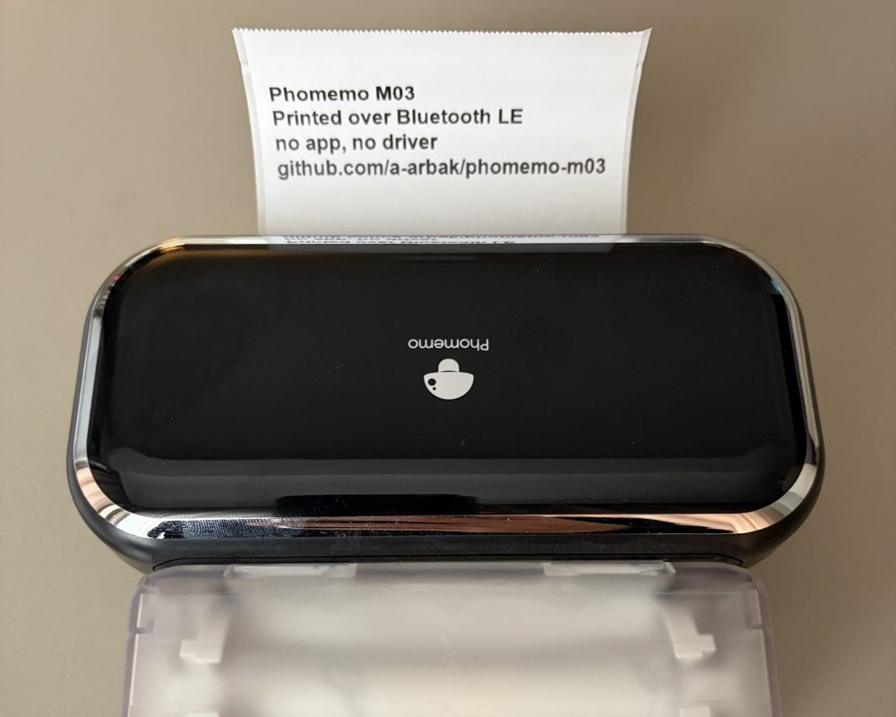

# phomemo-m03

Print to a **Phomemo M03** thermal printer (80 mm, 203 dpi) from a computer over **Bluetooth LE**, with no vendor app and no driver.

<p align="center"></p>

<p align="center"><sub>Printed with <code>python phomemo_m03.py text "Phomemo M03" "Printed over Bluetooth LE" "no app, no driver" "github.com/a-arbak/phomemo-m03" --size 34</code></sub></p>

The repository contains:
- **`phomemo_m03.py`**, a small Python command-line tool for text, images, paper feed, status and raw commands.
- **`web/index.html`**, a single-file Web Bluetooth console for Chrome and Edge.
- **[`PROTOCOL.md`](PROTOCOL.md)**, the documented command set and status replies, plus the pitfalls found while reverse-engineering it.

> Unofficial project. Not affiliated with or endorsed by Phomemo or Zhuhai Quin Technology.

## Quick start (Python)

```bash
pip install -r requirements.txt

python phomemo_m03.py info                                # firmware, battery
python phomemo_m03.py text "Hello M03!" "Second line" --size 40
python phomemo_m03.py image photo.jpg --dither --density 4
python phomemo_m03.py text "Draft" --preview out.png      # also save the raster as PNG
python phomemo_m03.py feed --lines 4
python phomemo_m03.py raw "1f1107"                        # send raw hex
```

The tool finds the printer by its advertised name (`M03`). Use `--address` to pick one explicitly, and `-v` to see every byte sent and received.

Requires Python 3.10+ with [bleak](https://github.com/hbldh/bleak) and [Pillow](https://python-pillow.org). Tested on Windows 11 (photo above). Linux and macOS should work wherever bleak does.

## Quick start (browser)

1. Serve the folder locally. Web Bluetooth needs a secure context: `localhost` or HTTPS.
   ```bash
   python -m http.server 8000
   ```
2. Open http://localhost:8000/web/ in Chrome or Edge.
3. Click **Connect** and choose **M03**.
4. Type some text, or load an image, then click **Print**.

The console also lists the discovered GATT services, lets you send raw hex commands, and logs every notification.

## How it works, in short

```
ff02  ←  1B 40                      reset
         1F 11 02 04                density
         1F 11 37 96                heat
         1F 11 0B                   continuous roll
         1F 11 35 00                no compression
         1F 11 88 03                anti-crease off
         1D 76 30 00 48 00 LL HH    GS v 0, 72 bytes/row
         <raster, 1 = black>
         1B 64 02 (×4)              feed
ff03  →  1A 0F 0C                   job finished
```

Full details, the status codes and the "stuck printer" trap are in [PROTOCOL.md](PROTOCOL.md).

## Troubleshooting

- **The printer is not found.** Close the Phomemo app on your phone, or turn off its Bluetooth. The printer accepts only one connection.
- **Nothing prints, and you only see `01 01` replies.** The printer is stuck from an earlier bad job. Power-cycle it.
- **The print stays inside the printer.** Increase `--feed`.
- **Windows shows "Driver unavailable"** for the paired M03. This is expected and harmless: printing goes through BLE GATT, not the Windows print spooler.

## Acknowledgements

- [vivier/phomemo-tools](https://github.com/vivier/phomemo-tools) for the original ESC/POS work on Phomemo printers.
- [transcriptionstream/phomymo](https://github.com/transcriptionstream/phomymo) for the multi-model Web Bluetooth label designer.

## License

[MIT](LICENSE)
